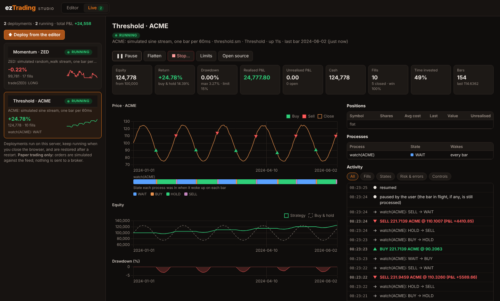
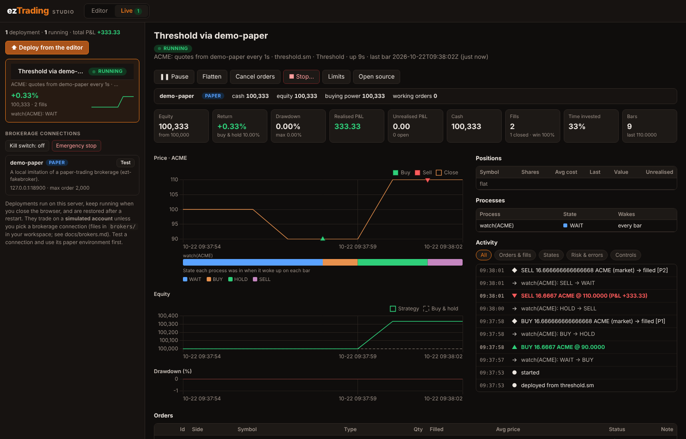

# eztrading

eztrading is a platform for writing, building and running automated trading
strategies. Strategies are written in **SML**, a small state-machine language
that compiles to C++; a set of cooperating servers builds them into plugins,
feeds them market data and runs them for users.

It also ships **`ezt-agent`**: an AI agent that writes, repairs and explains SML
strategies from plain-language descriptions, with every answer checked by the
real compiler.

> **Status: early prototype, not production software.** eztrading started in
> 2023 as a research/product prototype and is now open source. It is not
> audited, strategies can lose money, and nothing here is financial advice.
> Strategies can trade on a simulated account or, through a small JSON description,
> on a brokerage's API ([docs/brokers.md](docs/brokers.md)); that was only tested
> against local imitations, never a real brokerage. See
> [Project status](#project-status) for what works and what does not.

```sml
machine Threshold {
    param equities: Vec<Symbol> as "Equities";
    param account: Account = SandBox as "Brokerage Account";
    param floor: float = 10.0 as "Buy below";
    param ceiling: float = 15.0 as "Sell above";
    ...
    process watch(sym: Symbol) every 5 min {
        state WAIT: goto BUY on Tickers[sym] < floor;
        state BUY:  goto HOLD { pos = account.buy(sym, invest / Tickers[sym].close); }
        state HOLD: goto SELL on Tickers[sym] > ceiling;
        state SELL: goto WAIT { pos = account.sell(sym, pos.shares); }
    }
}
```

Full file: [`examples/threshold.sm`](examples/threshold.sm).

## Quick start

You need a recent stable Rust toolchain (<https://rustup.rs>), nothing else.

```sh
cargo build --workspace
cargo test --workspace

# Compile and lint a strategy (no API key needed)
cargo run -p agent -- check examples/threshold.sm

# Let the agent write one
export ANTHROPIC_API_KEY=sk-ant-...
cargo run -p agent -- generate "Buy AAPL after two consecutive down days, \
  sell at +10% or if it falls 5% below my entry" -o my_strategy.sm
```

`ezt-agent` is documented in [docs/agent.md](docs/agent.md).

### Strategy Studio

A browser editor for SML with live diagnostics, a state-machine diagram, a
backtest simulator with charts, strategy tests and the AI agent built in. It can
also **deploy** a strategy to run continuously on the server against a price feed
and give you a live dashboard to monitor, pause, flatten and audit it. Orders go to
a simulated account by default, or to a brokerage connection with limits, a kill
switch and restart recovery ([docs/brokers.md](docs/brokers.md)):

```sh
cargo run -p studio          # then open http://127.0.0.1:8787
```






*Synthetic data, for illustration.* Details: [docs/studio.md](docs/studio.md) and
[docs/live.md](docs/live.md).

## What is in the repository

| Path | What it is |
| --- | --- |
| `core/transpiler` | The SML compiler (`compile` binary): SML → C++. Grammar in `eztrading.pest`. |
| `core/agent` | `ezt-agent`, the AI strategy agent. |
| `core/broker` | Brokerage abstraction: `Broker` trait, paper broker, declarative REST adapter, limits and kill switch, record/replay, fake brokerages (`ezt-fakebroker`). |
| `core/studio` | Strategy Studio (`ezt-studio`): the browser editor with diagnostics, diagrams, backtests, tests and AI. |
| `core/engine` | Placeholder for the strategy execution engine. |
| `servers/com` | Shared library: wire protocol, data types, MySQL access, market-data providers' interfaces. |
| `servers/srvman` | Service manager: reads `system.toml`, starts and monitors the other servers, serves the HTTPS API. |
| `servers/datasrv` | Market-data server (Twelve Data provider). |
| `servers/jobsrv` | Runs compiled strategies for users, within a capacity limit. |
| `servers/codesrv` | Builds uploaded SML source into loadable plugins. |
| `servers/cli` | Interactive command-line client for the servers. |
| `package/` | C++ runtime headers/sources and the SML standard library (`libs/std.sm`) that generated code links against. |
| `docs/` | Documentation and the original design document, LaTeX source in `docs/Description` (build it yourself with `latexmk`). |
| `examples/`, `tests/` | Example strategies (with `.test.json` tests) and test fixtures. |

How the pieces fit together: [docs/architecture.md](docs/architecture.md).
The language: [docs/sml-language.md](docs/sml-language.md).

## Running the full platform

The servers are started by `srvman` from a `system.toml`:

```sh
cp system.example.toml system.toml      # then edit: database, paths, API key
secret/generate.sh                      # self-signed dev certificate (needs openssl)
export TWELVEDATA_API_KEY=...           # https://twelvedata.com (or set apikey in system.toml)
cargo build --workspace
cargo run -p srvman
```

Requirements and caveats you should know about before trying:

* **MySQL.** The servers use a MySQL database named `eztrading` (users,
  permissions, plugins, ...). **The schema is not in this repository yet**, so
  a fresh database will not work until it is added. This is the biggest gap.
* **C++ toolchain.** Building strategy plugins runs `pack.sh` and `make`, which
  need `clang` and (on Linux) `g++-10`. The paths in `package/Makefile` and
  `pack.sh` assume a Unix system; `compile` itself is portable.
* The platform as a whole has **not been run end to end** as part of
  open-sourcing; the pieces that are tested are listed below.

## Project status

| Area | State |
| --- | --- |
| SML compiler (`compile`) | Builds on current Rust; parses and generates C++ for the examples. Reports syntax errors with line/column and exits non-zero on failure. **Semantic checking is shallow**: member access, call arguments and `goto` targets are not verified. |
| `ezt-agent` | Unit-tested; the agent loop was exercised end to end against a local stand-in for the API. It has **not** been evaluated against the live API on a benchmark of requests. |
| Live deployments | Run inside Studio on a simulated account; restart recovery is tested bit for bit. The Twelve Data feed was tested only against a local stand-in, not the real service. Not connected to `srvman`/`jobsrv` ([docs/live.md](docs/live.md)). |
| Brokerage connections | A `Broker` trait, a paper broker, a declarative REST adapter, limits, kill switch and replay-based recovery ([docs/brokers.md](docs/brokers.md)). Tested only against two local imitations of brokerage APIs; the shipped Alpaca and Tradier descriptions are **unverified** against the real services. Real-money use is gated behind `--allow-live`. |
| Strategy Studio | Unit-tested (parser, analysis, diagram, simulator, tests, API) and driven end to end in a real browser. The simulator is a preview of the C++ runtime, not the runtime itself (see [docs/studio.md](docs/studio.md#what-the-simulator-does-and-does-not-do)). |
| `srvman`, `datasrv`, `jobsrv`, `codesrv`, `cli` | Compile. Not tested end to end (needs MySQL schema, see above). |

Known limitations and a good place to start contributing: the missing database
schema, semantic checks in the compiler, a larger SML standard library
(indicators, order types), Windows support, and tests for the servers.

## Security

* Never commit credentials. `system.toml`, `.env` files and `secret/*` are
  git-ignored; use the `*.example` files as templates.
* Strategies can embed raw C++ (``). That code runs natively inside the
  job server, so treat uploaded strategies as untrusted code and sandbox
  `codesrv`/`jobsrv` accordingly. `ezt-agent` refuses to emit inline C++ by default.
* See [SECURITY.md](SECURITY.md) to report a vulnerability.

## Contributing

See [CONTRIBUTING.md](CONTRIBUTING.md). Issues and pull requests are welcome.

## License

[MIT](LICENSE).
