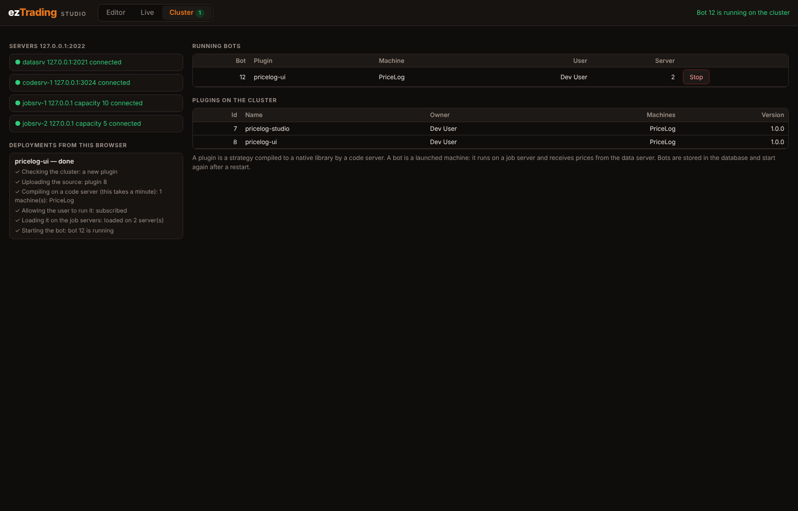

# The server cluster

Besides running strategies inside Studio, eztrading has a set of servers that compile strategies to
native plugins and run them as long-lived **bots**, several at a time, on several machines. This page
says how to start the cluster, how to use it from the CLI and from Studio, and what was and was not
tested.

```
Studio / CLI ──► srvman ──ssh──► starts datasrv, codesrv, jobsrv (any number, on any machines)
                  │ │ │
                  │ │ └──► jobsrv ◄── prices ── datasrv ◄── Twelve Data (REST + websocket)
                  │ └────► codesrv   compiles SML → C++ → a plugin (.so), stores it in MySQL
                  └──────► MySQL     users, plugins, subscriptions, bots
```

* **srvman** reads `system.toml`, starts the other servers over SSH, restarts the ones that die,
  and is the single address clients talk to (default port 2022).
* **datasrv** streams prices (Twelve Data) to every job server that asked for a symbol.
* **codesrv** turns an uploaded strategy into a plugin with `compile` + `g++` and stores it.
* **jobsrv** loads plugins, launches machines (bots) with their parameters, feeds them prices and
  restarts the bots stored for it after a restart.

> **Status.** This runs end to end on one machine (several server processes on localhost), against a
> local stand-in for Twelve Data. It was **not** tested on several machines, with the real Twelve Data
> service, under load, or for long periods. The protocol between servers has no authentication beyond
> a handshake token: **never expose the cluster ports**. A strategy with inline C++ (``) runs as
> native code on the cluster. See [Limits](#limits).

## Set it up

You need: Rust, `g++` (C++20), `clang`, OpenSSL, `ssh`, and MySQL or MariaDB.

1. **Build** everything and the scheduler library the job servers load:

   ```sh
   cargo build --workspace
   make scheduler CC=g++          # writes package/common/scheduler.so
   secret/generate.sh             # a self-signed certificate (data server websocket, srvman HTTPS)
   ```

2. **Database**: create the schema (reconstructed from the queries in `servers/`) and a user:

   ```sh
   mysql -uroot -p < db/schema.sql         # database `eztrading`, tables, and a development user #1
   ```

3. **SSH**: srvman starts servers with `ssh user@host`. For one machine, make
   `ssh localhost true` work without a password (a key in `authorized_keys`).

4. **Configure**: copy `system.example.toml` to `system.toml` in the repository root, fill in the MySQL
   password, your user, and **absolute paths** (the commands run in the SSH user's home directory).
   Set the data server's `apikey` (or `TWELVEDATA_API_KEY`) and the `symbols` it streams: bots can only
   listen to symbols the data server streams.

5. **Start**:

   ```sh
   scripts/cluster.sh up           # starts srvman, which starts the rest; logs in ~/.eztrading/
   cargo run -p cli -- -s 127.0.0.1:2022
   ```

   Without a Twelve Data account you can use the local stand-in
   (`pip install websockets; python3 tools/fake_twelvedata.py`) and tell the data server where it is with
   `TWELVEDATA_API_URL=http://127.0.0.1:3030` and `TWELVEDATA_WS_URL=ws://127.0.0.1:3030` in the SSH
   user's environment (for example `/etc/environment` when PAM is enabled). The stand-in imitates the
   shape of the API; it is not the service.

## Use it from the CLI

```
list servers | users | plugins | bots | machines
upload examples/pricelog.sm --user 1      # stores the source (syntax-checked)
build 1                                   # compiles it on a code server (a minute)
subscribe --user 1 --plugin 1 --expire 365
load 1                                    # loads the plugin on every job server
launch plugin_1::PriceLog --user 1 --set "equities=AAPL,BTC/USD"
stop 3                                    # a bot id from `list bots`
```

`--set "name=value ..."` sets parameters of type `float`, `double`, `int`, `bool` and `Vec<Symbol>`
(comma-separated). Others keep their defaults.

## Use it from Studio

Start Studio with the srvman address:

```sh
cargo run -p studio -- --srvman 127.0.0.1:2022      # or EZT_SRVMAN=...
```



A **Cluster** tab shows the servers, the running bots (with a Stop button) and the plugins, and the editor
gets a **⬆ Cluster** button. It asks for a plugin name, the machine, the user and the parameters, then
runs the same steps as above and shows each one: upload, compile, subscribe, load, launch. Deploying a
strategy again under the same name stops the old bot, rebuilds and starts a new one. Strategies with
inline C++ are refused. Studio endpoints: `GET /api/cluster`, `POST /api/cluster/deploy`,
`GET /api/cluster/tasks[/{id}]`, `POST /api/cluster/bots/{id}/stop`.

`tools/cluster_e2e.py` runs the whole path against a running cluster and Studio (deploy, wait for a real
price in the job server's log, redeploy, stop).

## What a bot is, and what happens on a restart

A bot is a launched machine. Launching stores a row in `bots` (with the job server's id) and starts the
machine on a scheduler thread; the job server asks the data server for the symbols in the machine's
`Vec<Symbol>` parameters, and every price update wakes the processes that `listen` to it. After a restart a
job server loads the plugins of its stored bots and starts them again; srvman numbers servers by the
sorted names in `system.toml` so the ids are stable. Plugins are written to a new file on every load (a
loaded library must never be overwritten).

## Limits

* **The C++ runtime is much simpler than Studio's.** Its `SandBox` account only counts shares: no cash,
  fills, fees, limit or stop orders, and no brokerage. Those exist only in Studio's runtime
  ([brokers.md](brokers.md)). Strategies using `buy_limit` etc. do not compile for the cluster.
  Putting a brokerage behind the C++ runtime is not done.
* Parameters of type `duration`, `Account` and others cannot be set from text and keep their defaults.
* Prices are the last trade (open = high = low = close). A symbol the data server does not stream gets
  no updates.
* `list machines` and parameter queries ask any one job server.
* The wire protocol has no request ids; Studio skips answers of the wrong kind, but a second client
  talking at the same moment is not something it was designed for.
* There is no authentication or authorization: any client that reaches srvman can launch anything. The
  SSH key used by srvman is a powerful credential. Run the cluster on a private network.
* srvman's HTTPS API (port 8080) is still the original placeholder.
* Not tested: several machines, the real Twelve Data service, many bots, long runs, MySQL replication.

## Fixes this work needed

For the record, running the cluster end to end uncovered things that had never worked, now fixed: the C++
runtime did not compile with a current compiler (and the Makefile hard-coded `g++-10`); srvman answered
every `list` request except machines with `todo!()` and crashed; jobsrv ignored the prices pushed by
datasrv and launched machines with the plugin's default parameters instead of the user's; launching never
committed the `bots` row; `Vec<Symbol>` parameters were raw memory images that no client could create;
member access on a signal (`Tickers[sym].close`) produced C++ that did not compile; and reloading a plugin
overwrote the mapped library and killed the job server.
