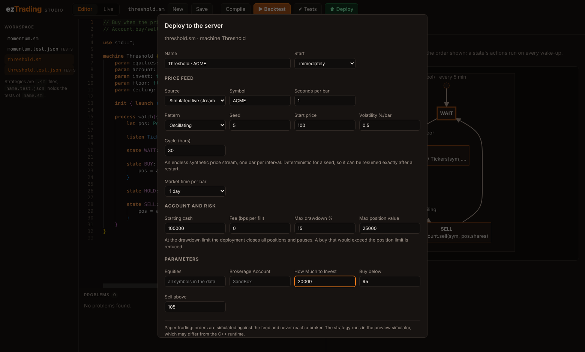

# Deploying and monitoring strategies (paper trading)

Strategy Studio can **deploy** a strategy: run it continuously on the server
against a price feed, keep it running when you close the browser, and let you
watch, manage and audit it from the **Live** tab.

> **By default this is paper trading.** Orders are simulated against the feed at
> the latest price with a simulated cash balance. A deployment can instead send
> its orders to a brokerage connection; see [brokers.md](brokers.md) for that and
> for its safety limits. The strategy runs in Studio's
> preview simulator (see [studio.md](studio.md#what-the-simulator-does-and-does-not-do)),
> not in the C++ runtime or the `srvman`/`jobsrv` servers: those need a MySQL
> schema that is not in the repository, so they cannot be driven from here yet.

## Deploy

Open a strategy in the editor and press **⬆ Deploy**. The dialog asks for:

| Section | What you choose |
| --- | --- |
| Name, start | A label, and whether it starts running or waits paused |
| Price feed | Simulated stream, replay of a history, or live quotes (below) |
| Market time per bar | What one bar means to the strategy, so `every 5 min` / `every 1 day` map to a number of bars exactly as in a backtest (live quotes use the poll interval) |
| Account and risk | Starting cash, fee, **max drawdown %**, **max position value** |
| Parameters | The strategy's `param`s |

The deployment gets a snapshot of the editor's current text (unsaved changes
included), so later edits do not affect it. To change a deployment, deploy the
new version and stop the old one. Deploying is refused with the reason if the
strategy has a syntax error or an analysis error (for example a `goto` to a state
that does not exist).

### Feeds

| Feed | Behaviour |
| --- | --- |
| **Simulated** | An endless synthetic stream (random walk, oscillating, trends, crash), one bar per interval. Deterministic for a seed, so it can be resumed exactly after a restart. |
| **Replay** | Plays a generated or pasted CSV history one bar per interval, then the deployment is *finished*. The quickest way to watch a strategy live through a past market. |
| **Twelve Data** | Polls the latest price of each symbol every `interval_secs` (5 s to 24 h) using `TWELVEDATA_API_KEY` from the server's environment (`TWELVEDATA_BASE_URL` can point at a proxy). Each poll becomes one bar (open = high = low = close). The key is never stored or sent to the browser, and is stripped from error messages. |

Twelve Data support is covered by tests against a local stand-in for the HTTP
API; **it has not been exercised against the real service**. Market hours,
rate limits and missed polls are not handled specially: a failed poll is logged
and retried on the next interval, and after 10 failures in a row the deployment
pauses itself.

## Monitor

Select a deployment in the list (status, return, equity, sparkline and the state
of each process at a glance). The detail view shows:

* **KPIs**: equity, return against buy-and-hold, current and maximum drawdown,
  realised and unrealised P&L, cash, fills (and win rate), time invested, bars
  processed.
* **Charts**: price with buy/sell markers, a **state timeline** per process,
  equity against buy-and-hold, drawdown. They update every second.
* **Positions** (size, average cost, last price, value, unrealised P&L) and
  **processes** (current state, how often each wakes).
* **Activity**: the audit trail, newest first, filterable. Every fill, every
  state transition, anything the strategy `printf`s, risk-limit actions,
  warnings (such as cash running out), feed errors, and every control action
  (deployed, started, paused, resumed, flattened, limits changed, stopped,
  restored after a restart).
* **Trades**: every fill with its P&L.

## Manage

| Action | Effect |
| --- | --- |
| **Pause** / **Resume** | Stops/restarts the clock. The bar being fetched at that moment is still processed. |
| **Flatten** | Sells every open position at the latest price; the strategy keeps running (and may open new positions). |
| **Stop…** | Final. Choose to close positions first or leave them open in the record. A stopped deployment cannot be resumed; deploy it again. |
| **Limits** | Change the drawdown and position limits while running. |
| **Open source** | Loads the deployed snapshot into the editor (as an unsaved buffer). |
| **Delete** | Removes a finished deployment and its history from the server. |

Statuses: **running**, **paused** (by you, by the drawdown limit, or after
repeated feed failures; the reason is shown), **stopped** (by you),
**finished** (a replay reached its end, or the 100,000-bar limit), **error** (the
strategy failed at run time; the message and line are shown). Stopped, finished
and error are final.

### Risk limits

* **Max drawdown %**: when the equity falls this far below its peak, the
  deployment closes all positions and pauses, and says so in the activity log. It
  triggers once per breach (it re-arms when the drawdown is back under the
  limit), so resuming while still below the limit does not loop.
* **Max position value**: a buy that would take a position above this value is
  reduced to fit, and the reduction is logged.

These are enforced by the engine on every bar. For a deployment that trades
through a brokerage there are further limits enforced outside the strategy
(order value, position value, order count, kill switch); see
[brokers.md](brokers.md#safety).

## Persistence and recovery

Each deployment lives in `<workspace>/.live/<id>/`:

| File | Content |
| --- | --- |
| `deployment.json` | Configuration, the strategy snapshot and the current status |
| `log.jsonl` | Append-only: every bar delivered and every manual command that affects the engine (flatten, position-limit change), in order |
| `events.jsonl` | The activity log |

The engine is deterministic, so after a restart each deployment is **rebuilt by
replaying `log.jsonl`**: positions, cash, equity and process states come back
exactly (this is tested bit for bit), and a deployment that was running simply
continues. Paused and final deployments stay as they were; if a feed cannot be
reopened (for example the Twelve Data key is gone), the deployment comes back
paused with the reason. A write cut off by a crash leaves at most one torn last
line, which is ignored. The restart is recorded in the activity log.

What recovery cannot do: bars that a live-quote feed would have delivered while
the server was down are gone, so the strategy sees consecutive polls across the
gap.

A lock file keeps two Studio servers from running the same workspace's
deployments.

## Limits

At most 50 deployments (10 running at once), 20 symbols per feed, and 100,000
bars per deployment (after which it finishes). Each deployment runs in its own
thread. Events beyond the newest 20,000 stay in `events.jsonl` but drop out of
memory.

## HTTP API

| Endpoint | Purpose |
| --- | --- |
| `GET /api/live` | All deployments (summaries) and the server's limits |
| `POST /api/live` | Deploy (`name`, `source`, `strategy_file?`, `machine?`, `params`, `feed`, `bar_seconds?`, `initial_cash`, `fee_bps`, `max_position_value?`, `max_drawdown_pct?`, `start`) |
| `GET /api/live/{id}?bars_from=&trades_from=&after_seq=&tail=` | Detail. The cursors return only what is new, which is how the UI polls once a second. |
| `POST /api/live/{id}/{pause,resume,stop,flatten,cancel-orders}` | Control (`stop` takes `{"flatten": true}`) |
| `POST /api/live` with `execution` | Trade through a brokerage connection instead of the simulated account ([brokers.md](brokers.md#api)) |
| `PUT /api/live/{id}/limits` | Set `max_drawdown_pct` / `max_position_value` (`null` removes a limit; omit to leave it) |
| `GET /api/live/{id}/source` | The deployed snapshot |
| `DELETE /api/live/{id}` | Delete a final deployment |

Writes must be `application/json` and, if the browser sends an `Origin`, it must
be one of Studio's own. Together with the `Host` allow-list this stops other web
pages from controlling your deployments (see [studio.md](studio.md#security)).

## What is not here

A tested adapter for any real brokerage (the descriptions in `brokers/` are
unverified), running deployments on `jobsrv`, alerts and notifications, user
accounts and permissions, and live tick data. The deployment engine is a good
seam for `jobsrv`: a backend there would replace the in-process stepping while
keeping the lifecycle, audit log and UI.
