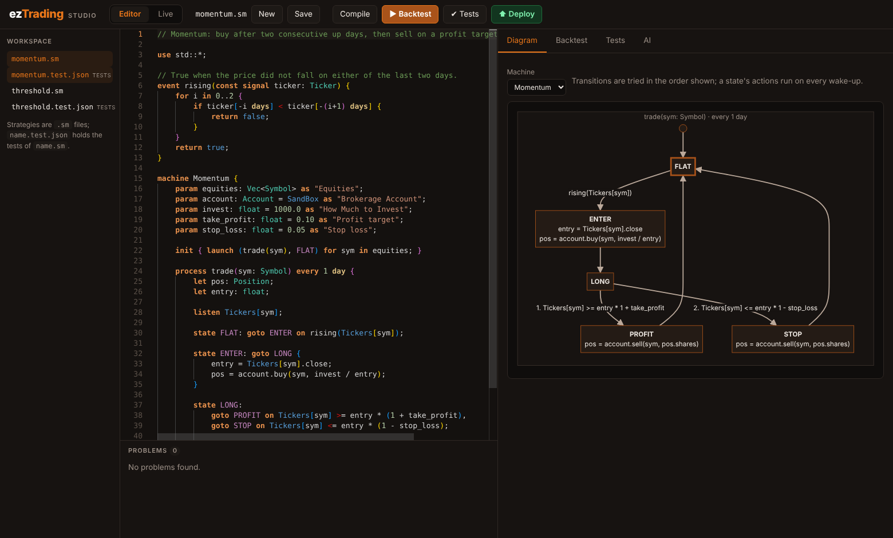
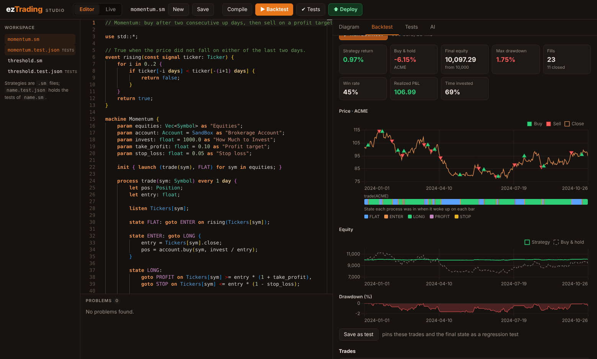
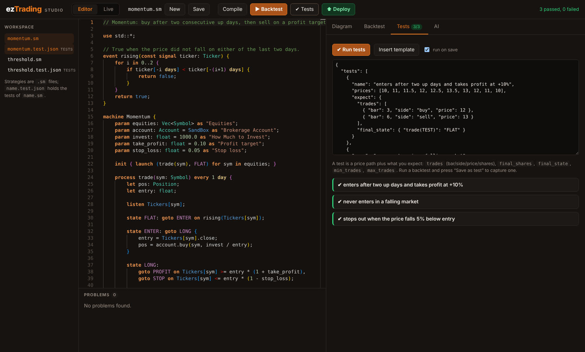

# Strategy Studio

Strategy Studio is a browser-based editor for SML strategies. It runs on your
machine as a single Rust binary (`ezt-studio`) and gives you, next to the code:

* **live diagnostics** as you type, with the exact line and column;
* a **state-machine diagram** of the strategy, redrawn on every edit;
* a **backtest simulator** with price, equity, drawdown and state-timeline charts
  and a trade list;
* **strategy tests**: declare a price path and the behaviour you expect, run
  them in one click, or capture a backtest as a regression test;
* an **AI tab** that writes, fixes and explains strategies (the same agent as
  [`ezt-agent`](agent.md));
* **deployment**: press **⬆ Deploy** to run a strategy continuously on the server
  against a price feed, then monitor, manage and audit it in the **Live** tab
  (paper trading; see [live.md](live.md)).



## Run it

```sh
cargo build --workspace          # builds the SML compiler that the Compile button uses
cargo run -p studio              # then open http://127.0.0.1:8787
```

Run it from the repository root (it reads the standard library from
`package/libs`). The first start creates `./strategies/` and fills it with the
example strategies and their tests; point `--dir` somewhere else to use your own
folder.

| Option | Environment | Default | Meaning |
| --- | --- | --- | --- |
| `--dir` | | `strategies` | Workspace folder with your `.sm` and `.test.json` files |
| `--host`, `--port` | | `127.0.0.1`, `8787` | Where to listen. Keep it on loopback (see [Security](#security)). |
| `--allow-host` | | | Extra `Host` name to accept (behind a reverse proxy). Repeatable. |
| `--compiler` | `EZT_COMPILER` | `compile` next to `ezt-studio`, then `PATH` | SML compiler binary |
| `--stdlib` | `EZT_STDLIB` | `package/libs` | Standard library folder |
| `--model`, `--effort` | `EZT_AGENT_MODEL`, `EZT_AGENT_EFFORT` | `claude-opus-5-5` | Model for the AI tab |
| `--no-ai` | | | Disable the AI tab even if a key is set |
| | `ANTHROPIC_API_KEY` | | Enables the AI tab |

The page loads three libraries from the jsDelivr CDN at pinned versions, so
**the first load needs internet access**: [Monaco](https://microsoft.github.io/monaco-editor/)
0.50.0 (editor), [Mermaid](https://mermaid.js.org) 10.9.1 (diagrams) and
[Chart.js](https://www.chartjs.org) 4.4.3 (charts). The three entry scripts are
integrity-checked (SRI); Monaco loads its remaining modules from the same pinned
package.

## Diagnostics

Problems come from four places and appear in the **Problems** list and as
squiggles in the editor:

| Source | When | Examples |
| --- | --- | --- |
| Parser | as you type | `syntax error: unexpected `of`, expected …` with line and column |
| Analysis | as you type | `goto` to a state that does not exist; `launch` of an unknown process; unreachable states; a process that is never launched; unused parameters; orders in a state whose transitions are all guarded (they repeat on every wake-up) |
| Compiler | **Compile** button | whatever the real `compile` binary rejects |
| Simulator | after a failed backtest | the line of a construct it cannot run |

The real compiler checks only syntax and a few names; it accepts a `goto` to a
state that does not exist. The analysis exists to cover that gap, so look at both.

## Diagram

The **Diagram** tab draws one box per state (with its actions), one arrow per
`goto` (labelled with its guard), a dot for the state each process is launched
in, and numbers the transitions of a state in the order they are tried.
Terminal states are dashed. If the source has a syntax error the last valid
diagram stays visible, dimmed.

## Backtest

The **Backtest** tab runs the strategy on price data and shows the result.

* **Data**: a synthetic series (random walk, oscillating, uptrend, downtrend,
  crash; deterministic for a given seed) or pasted/uploaded **CSV** (`close`,
  `date,close` or `date,open,high,low,close,volume`; header optional).
* **Account**: starting cash and a fee in basis points per fill.
* **Parameters**: a form generated from the machine's `param`s. Leave a field
  empty for the default; values such as `5 min` are parsed as SML expressions.
* **Results**: return vs buy-and-hold, final equity, max drawdown, fills, win
  rate, realised P&L, time invested; charts of price with buy/sell markers, a
  **state timeline** (the state each process was in on each bar, aligned with the
  price axis), equity vs buy-and-hold, and drawdown; the trade list with per-trade
  P&L; and anything the strategy printed with `printf`.



> The charts above use synthetic data and prove nothing about a strategy.

### What the simulator does, and does not do

It interprets the strategy and follows the execution model of the generated C++
(see [sml-language.md](sml-language.md#processes-and-states)): a process wakes on
its interval (every bar if it `listen`s), runs the actions of its current state,
then tries the `goto`s in order, and the new state runs on the next wake-up.

| Behaviour | In the simulator |
| --- | --- |
| Time | One step per bar. `every 3 days` on daily bars wakes every 3rd bar; a process that `listen`s wakes every bar. A time of day (`at 09:30`) is ignored. |
| Orders | `account.buy/sell(sym, shares)` fill at the bar's **close**, against a simulated cash balance (a buy is reduced, with a warning, if cash runs out), minus the fee. Limit and stop orders (`buy_limit`, `sell_stop`, ...) rest and fill when a later bar's high/low range reaches them. No slippage, spreads or liquidity. See [brokers.md](brokers.md#orders-in-sml). |
| History | `ticker[-1 day]` looks back by `duration / bar size` bars. Until enough history exists the process simply does not act. Looking into the future is an error. |
| `SandBox` | The runtime's `SandBox` only counts shares; the cash and P&L here exist only in the simulator. |
| Events, `for`, `while`, `loop`, `if`, `static`, `printf` | Supported (`while` and `loop` stop with an error after 10,000 iterations, since SML has no `break`). |
| Not simulated | Inline C++ (``), `Ticker.history()`, `record`, `emit`, generic types. These **stop the run with an error naming the line**; nothing is skipped silently. `fn` and `class` are not modelled at all: calling one fails as an unknown function. |

It is a preview, not the C++ engine: treat a good backtest as "the logic does
what I meant", not as evidence of future performance.

## Tests

The **Tests** tab edits `name.test.json`, the tests of `name.sm`:

```json
{ "tests": [ {
    "name": "buys below the floor and sells above the ceiling",
    "prices": [12, 11, 9, 9.5, 16, 17],
    "params": { "floor": 10, "ceiling": 15 },
    "expect": {
      "trades": [ { "bar": 3, "side": "buy", "price": 9.5 }, { "bar": 5, "side": "sell" } ],
      "final_shares": 0,
      "final_state": { "watch(TEST)": "WAIT" }
    }
} ] }
```

| Field | Meaning |
| --- | --- |
| `prices` | Close prices, one per daily bar, for the symbol `TEST` (or `symbol`) |
| `params`, `machine` | Parameter overrides; which machine when the file has several |
| `expect.trades` | The exact sequence of fills; only the fields you give (`bar`, `side`, `shares`, `price`) are compared |
| `expect.min_trades`, `max_trades` | Bounds on the number of fills |
| `expect.final_shares` | Shares held of the symbol after the last bar |
| `expect.final_state` | State of each process instance at the end, e.g. `"watch(TEST)": "WAIT"` |
| `expect.final_equity_at_least`, `max_drawdown_pct_at_most` | Result bounds |

A failing test says what differed (`expected a sell but it was a buy`,
`expected it on bar 2 but it happened on bar 3`). **Run on save** re-runs the tests
every time you save. After a backtest, **Save as test** pins its prices, trades and
final state as a regression test, which is a quick way to lock in behaviour you
have checked by eye.



The same files are checked in CI for the shipped examples
(`cargo test -p studio`).

## AI tab

With `ANTHROPIC_API_KEY` set, the tab can **generate** a strategy from a
description, **fix** the problems in the editor, or **explain** the strategy and
its risks. It is the [`ezt-agent`](agent.md) loop: the model proposes, the real
compiler checks, the model repairs, and only an accepted strategy comes back.
Review the result, run the tests and paper-trade before using real money. Each
request makes several paid API calls; the token use is shown with the result.

## Security

Studio is a local development tool with no login.

* It listens on `127.0.0.1` by default and answers only to the `Host` names
  `localhost`, `127.0.0.1`, `[::1]` and any `--allow-host` you add, which blocks
  DNS-rebinding attacks from other web pages.
* Mutating requests must be `application/json`, so another website cannot
  trigger them without a CORS preflight, which is never granted. A request that
  carries an `Origin` header must come from one of Studio's own origins, which
  also covers the cross-site "simple" requests that skip preflight.
* It reads and writes only `*.sm` and `*.test.json` files **directly inside** the
  workspace folder (no subfolders, no `..`), at most 256 KiB each.
* Diagram labels are escaped and rendered by Mermaid in strict mode; all other
  text is inserted into the page as text.
* The AI tab uses your API key on your behalf, so do not expose Studio to other
  people (`--host 0.0.0.0` prints a warning). The compiler is only ever asked to
  translate SML to C++; nothing is built or executed.

## HTTP API

The page is a thin client over a JSON API you can script (the deployment
endpoints are in [live.md](live.md#http-api)):

| Endpoint | Purpose |
| --- | --- |
| `GET /api/files`, `GET`/`PUT /api/files/{name}` | List, read, write workspace files |
| `POST /api/analyze` `{source, machine?}` | Diagnostics, diagram (JSON + Mermaid), parameters |
| `POST /api/compile` `{source}` | Run the real compiler |
| `POST /api/backtest` `{source, params, data, bar_seconds, initial_cash, fee_bps}` | Simulate; returns the backtest and a captured test |
| `POST /api/test` `{source, tests}` | Run a `.test.json` document against a strategy |
| `GET /api/ai/status`, `POST /api/ai/{generate,fix,explain}` | AI features |

Domain errors (a strategy that cannot be simulated) come back as HTTP 200 with
`"ok": false` and a message; malformed requests are HTTP 400.

## Code map

`core/studio/src`: `syntax.rs` (the compiler's grammar, reused), `ast.rs` /
`model.rs` (strategy structure), `analyze.rs`, `diagram.rs`, `market.rs` (CSV and
generators), `sim.rs` (interpreter, the incremental `Engine`, backtest), `testing.rs`,
`feed.rs` and `live.rs` (price feeds and the deployment manager), `server.rs`
(API); the UI is `core/studio/assets/` (`index.html`, `app.js`, `app.css`,
`sml-language.js`), embedded in the binary.
